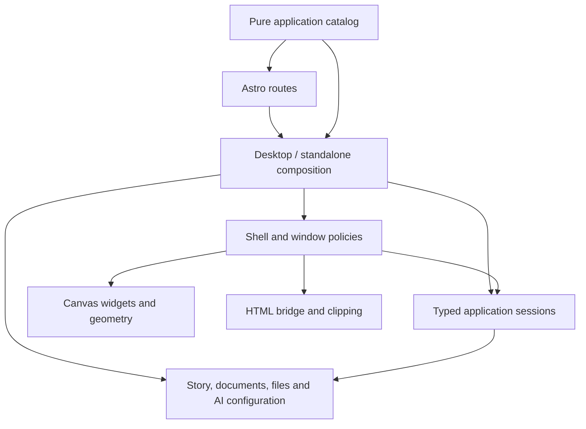

# MHK10 architecture and engineering standards

MHK10 retains the 640×360 immediate-mode canvas desktop and embeds real HTML content in managed windows. Static Astro routes remain independently addressable. The user name is MiraHikari; legacy storage and message keys retain their `doom95` prefix so the brand change does not discard data.

Desktop storage identities live in the zero-import `src/data/storage-keys.ts`.
Shared Reader keys live in `packages/site-core/src/fusion/reading-storage.ts`.
The immutable `VGA_COLORS` order and theme bundles live in `gfx/palette.ts`;
`themeFor()` validates names and HTML theme CSS is generated from the same
palette. Settings use its supported theme, sound and cursor lists.

## Modules and composition

- `src/data/app-catalog.ts` owns public identity, routing, window metadata and menu placement. Canvas applications author those registration facts in zero-import `*.registration.ts` sidecars beside their implementations under `src/lib/apps`; `scripts/generate-app-catalog.mjs` recursively discovers sidecars, validates their IDs and geometry, rejects duplicate IDs, and records each implementation's module path in the zero-import snapshot `src/data/app-catalog.generated.ts` (`npm run generate:app-catalog`). The authored wrapper adds the `NON_CANVAS_APPS` seed entries and the curated `CATALOG_ORDER` sequence. A freshness test rejects stale snapshots. `src/lib/apps/eager.ts` reconciles the desktop's implementations in product order; `src/lib/apps/index.ts` loads only the requested application for standalone routes. Models, tests and registration sidecars do not register. Personal About uses `profile`; system About uses `system-about`. `/about/`, `/apps/about/` and legacy host-specific `about` commands remain compatible.
- `os/files/file-types.ts` owns extension metadata and the discriminated open resolver. The desktop, standalone hosts and embedded bridge share it; unregistered executable payloads are never run.
- `os/files/filesystem.ts` owns the hierarchical visitor volume, trusted read-only publication library and revisioned persistence. Browser composition supplies IndexedDB assets and same-origin public asset loading.
- `os/files/native-file-bridge.ts` is the embedded Reader/ACDSee file channel. It validates iframe identity, request shape, payload size and timeouts before touching the shared file services.
- `os/host/app-contracts.ts` separates durable `AppServices` from `AppFrame` drawing, time, scoped input and readonly window projections. `defineCanvasApp` exposes metadata and `createSession`, keeping authoring state private. HTML applications supply a URL and window metadata.
- File applications receive Save As, backup download, import limits and native file operations through `AppServices`. `html-app-services.ts` owns the Reader/ACDSee native channel and its lifetime. Applications do not import concrete file dialog, backup, download or channel implementations. HTML window owners checkpoint reading before closing or replacing a source; disposal releases resources.
- Canvas applications also receive asynchronous text clipboard, cancellable external-file selection and file-audio playback through `AppServices`. Hosts choose the concrete browser adapters; sessions release acquired pickers and audio on disposal or failed initialization. File selection returns selected/cancelled/failed results, and file audio exposes readiness, errors, playback and position. Display applies only preferences changed in its dialog; the host persists wallpaper selection.
- `os/host/desktop-entry.ts` and `app-host.ts` compose browser adapters and domain instances. Each canvas owns its renderer, fonts, theme, effects, input and audio through `CanvasSurfaceRuntime`; independent canvases can coexist. One canvas rejects duplicate mounts.
- `os/desktop/shell.ts` composes and schedules frames. Boot, splash, shutdown and firmware painting live with DesktopLifecycle; the taskbar with DesktopChrome; desktop icons, property text and file-drag ghosts with DesktopWorkspace. DesktopLauncher owns application and file opening. MessageWindows owns modal message dialogs. DesktopFileDrag owns pointer file transfers. `desktop-command-model.ts` owns command identifiers, and `desktop-context-menu.ts` owns context-menu structure. `desktop-key-model.ts` orders shortcut tokens into the actions for one frame. `frame-paint-model.ts` decides when an idle frame may skip painting and when embedded HTML may composite. `frame-keys.ts` is the single prelude for which layer owns a frame's keys. `os/windows/wm.ts` owns geometry, focus, layering, the Ctrl+Tab switcher, half-work-area docking and animation behind commands and immutable snapshots. Shared popup/client geometry drives drawing, hit testing and iframe occlusion. Idle frames skip the desktop paint; a resolution change, input, animation, theme change or clock-second change paints again.
- `os/host/browser-bridge.ts` parses unknown messages, while the receiver validates both origin and source window. Application URLs resolve through the registered catalog. No generic RPC, executable message payloads or host shell commands are supported.
- `apps/reader/` owns ReaderSession persistence and import generations, and ReadingSurface text indexing, ranges, selection, highlights and pagination. `apps/acdsee/` owns image loading, cumulative local decoding and export lifetimes. `ui/browser/` owns reusable DOM lifetimes and comboboxes; `ui/canvas/` owns input, text editing, menus and widgets. Shared text and print layout live in `ui/text/`.

## Interface and lifetime rules

A Module has one public Interface: its types plus ownership, ordering, errors and lifetime rules. Keep the Interface small enough to document; concentrate rules where their callers and tests can share them. Introduce a Seam when behavior actually varies, such as Canvas/DOM save pickers or browser/in-memory storage.

Applications request closing; the session first consumes accepted frame input, waits for active saving, and then checks `onClose`. False, errors and unsuccessful saving keep the window usable. Repeated close requests share an operation. `dispose` is final resource release, is idempotent, and never substitutes for user-facing save/close approval.

Every listener, observer, subscription, animation and owned DOM node must have an owner and release path. Initialization failure and disposal during font loading must settle initialization without restarting a loop. Tests cover remounting without manually clearing product DOM.

Applications receive immutable input views and consume events through commands. Equal widget IDs in separate sessions have independent focus, scroll and drag state. Offscreen drawing receives its own bound renderer; exceptions restore target drawing state. The full ownership contract is documented in [Canvas runtime](canvas-runtime.md).

`Documents` owns revision comparisons, reset handling and delayed Save As adoption. `FileSystem` commits complete generated records once. A successful in-memory mutation with `persisted: false` is not a durable save: the editor retains its dirty state and offers export. Resetting documents and replaying the story are distinct operations.

`RuntimeSnapshot` reports both narrative baseline and current meter. Story transitions reset the meter; Up/Down retain their existing limits between transitions. Diagnostics use the same current meter as the host. Standalone legacy meter restoration remains supported.

## Change standards

1. Domain logic must not acquire DOM or browser globals, or depend on drawing/application implementations. Graphics must not import applications or OS logic. Applications must not import Shell. Composition roots are responsible for concrete adapters.
2. Use discriminated results for saved/cancelled/failed outcomes. Parse external JSON from `unknown`; type assertions do not validate stored data or messages.
3. Keep application state private. Window views are read-only; title changes and host operations cross explicit capabilities. Menu commands have stable identifiers separate from display labels.
4. Tests and callers use the same Interface. Prefer observable outcomes, failures, transitions and disposal to private-field assertions. Keep a fake only while it provides useful coverage not provided elsewhere.
5. New dependencies need a concrete purpose, a pinned reproducible version and actual compatibility checks. Development-only tools must not enter the browser bundle.
6. Keep two-space indentation, single quotes and semicolons. Format behavioral changes separately from broad mechanical cleanup. Do not add exceptions or raise a baseline to conceal a newly introduced violation.

## Verification

Use Node 24 and npm 11. `npm ci` follows the sole package lock. `npm run verify` runs type diagnostics, lint, formatting checks, architecture checks, Vitest, production build, site validation and Chromium end-to-end tests. The Windows workflow installs Chromium and preserves failure reports.

The architecture gate uses dependency-cruiser and an Astro compiler Adapter for frontmatter and script imports, including dynamic imports. Negative fixtures prove forbidden imports are rejected; type-only cycles are not runtime cycles.

All `src/lib/**/*-model.ts` modules inherit pure-domain rules automatically. Established domain names, desktop selection and reusable layout geometry are also covered. Registration sidecars reject every import, including type-only and dynamic imports, and cannot read browser globals. File ownership, naming and generated-asset workflows are defined in [project structure and implementation patterns](project-structure.md).

Formatting uses Vite+ for supported files and Prettier's Astro plugin for `.astro`. `npm run format -- <paths>` formats selected files; with no paths it targets new or modified files. `npm run format:baseline` only prunes obsolete legacy hashes. `format:check` is read-only and rejects changed nonconforming files.

Playwright operates Canvas through its logical coordinates and real keyboard input. Assertions inspect visible frames, dialogs, navigation, saved documents, exports and screenshots. Exact same-frame ordering remains a Vitest concern. Tests isolate browser storage and serve production `dist` without replacing a developer's running preview.

See [browser acceptance](browser-acceptance.md), [domain language](../GLOSSARY.md), and [architecture decision](adr/0001-shared-app-sessions.md).
Rendering selection and the Canvas/HTML boundary are defined in
[rendering-mode-standard](rendering-mode-standard.md); the command vocabulary
and focus rules are in [keyboard-shortcuts](keyboard-shortcuts.md).
